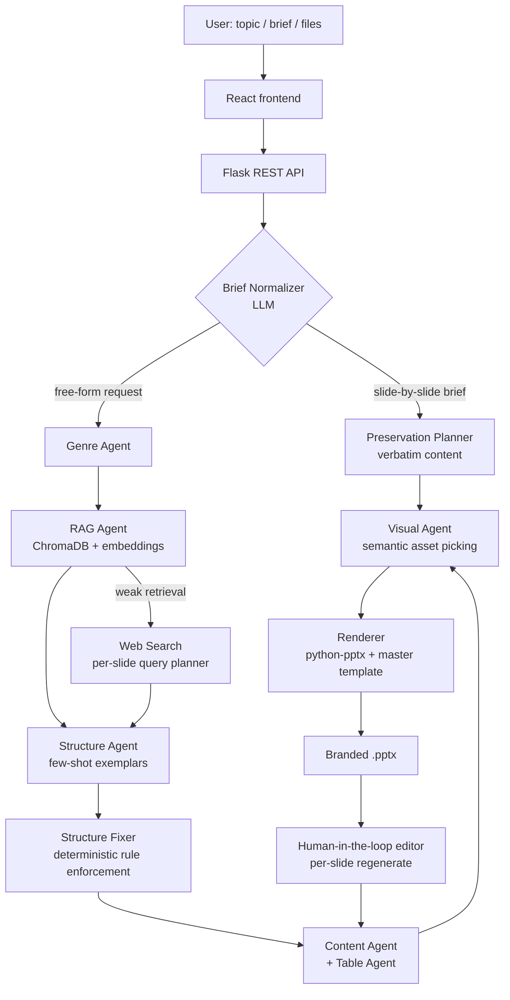

# AI Presentation Generator

**An agentic, RAG-powered system that turns a topic, a brief or an uploaded document into a fully branded, ready-to-present PowerPoint deck.**

Built end to end as the sole developer during my role as **Working Student – AI Developer at 3Kubik GmbH** (2026), a Microsoft 365 and digitalization consultancy. The system runs in production in two forms: an Azure-hosted web application and a desktop AI-assistant plugin used by consultants.

> ⚠️ **Note:** This is a project showcase. The source code, master templates, knowledge base and brand assets are proprietary to 3Kubik GmbH and remain private. Architecture and engineering decisions are described here with permission-safe detail only.

---

## Table of Contents

- [The Problem](#the-problem)
- [What It Does](#what-it-does)
- [Architecture](#architecture)
- [The Agent Pipeline](#the-agent-pipeline)
- [Key Features](#key-features)
- [Engineering Challenges Solved](#engineering-challenges-solved)
- [Tech Stack](#tech-stack)
- [Project Timeline](#project-timeline)
- [Results](#results)
- [Lessons Learned](#lessons-learned)
- [My Role](#my-role)

---

## The Problem

Consultants spend hours building workshop and training decks that must follow strict corporate design rules: a master template with **84 slide layouts**, specific rules for where brand characters and photos may appear, a recognisable tone of voice, and German-language content with correct typography.

Generic AI slide tools produce decks that look nothing like the company's real deliverables. The goal was a bot that produces output a consultant could present **with minimal editing**: on-brand, structurally correct, and grounded in the company's own knowledge.

## What It Does

1. **Input:** a topic, a detailed brief, or uploaded files (PDF, DOCX, PPTX, TXT, MD).
2. **Understands** the request: classifies the deck genre (training, workshop, strategy, pitch, discovery, concept overview) and detects language.
3. **Retrieves** relevant knowledge from an internal vector database of past presentations and documents, falling back to live web search when the topic is outside the knowledge base.
4. **Plans** the deck structure: slide sequence, layouts, section dividers, agenda, exercises.
5. **Writes** slide content in the company's voice, slide by slide.
6. **Selects visuals** semantically: brand characters, photos and section-divider imagery chosen by meaning, not keyword.
7. **Renders** a native `.pptx` from the official master template, with editable placeholders, tables, footers and page numbers.
8. **Lets the user refine** individual slides through a human-in-the-loop editor.

---

## Architecture

**Design principle:** *LLMs for understanding, deterministic code for rendering.* The language model decides what a slide should say and which layout fits its meaning. Python decides placeholder geometry, typography and brand rules. Every rule that must always hold is enforced in code after the LLM step, not just requested in a prompt.

---

## The Agent Pipeline

| Stage | Responsibility |
|---|---|
| **Brief Normalizer** | Reads briefs in any format (numbered slide outlines, prose, mixed) and converts them into a canonical JSON schema with sections, slides, content density and a layout hint per slide. Validates slide counts against the input and retries if content was dropped. |
| **Genre Agent** | Classifies the request into one of six deck genres, each with its own rules for length, exercise frequency, section dividers, openers, closers and bullet density. |
| **RAG Agent** | Semantic retrieval over the company knowledge base with a calibrated relevance threshold, per-source diversification and optional LLM re-ranking. |
| **Web Query Planner** | Scores each slide for its need for current external facts and plans up to four targeted searches per deck; sources are cited in the speaker notes. |
| **Structure Agent** | Plans the full deck using real company decks as few-shot exemplars, a machine-readable layout catalogue and a set of brand rules, with validator-driven retries that feed specific errors back to the model. |
| **Structure Fixer** | Deterministic post-processing: guarantees an agenda, enforces one layout family per section, caps layout repetition. |
| **Content Agent** | Writes each slide with focused retrieval, awareness of previous slides (no repetition), genre-specific density and robust JSON parsing with fallbacks. |
| **Table Agent** | Detects comparison and matrix content and produces real, brand-styled PowerPoint tables. |
| **Visual Agent** | Chooses brand characters, photos and section-divider images by reasoning over an AI-generated, enriched asset catalogue. |
| **Renderer** | Builds the deck from the master template, inserting pictures *into* placeholders (so they stay editable), auto-fitting fonts, cloning footers and page numbers. |

---

## Key Features

### Retrieval-Augmented Generation
- Knowledge base of **80+ presentations and company documents**, chunked and embedded into ChromaDB (2,500+ chunks).
- Multilingual embedding model so German and English queries retrieve equally well.
- Relevance threshold tuned empirically (separating real matches at 65–80% similarity from noise below 45%), with source diversification so slides don't repeat one document.
- Per-request in-memory RAG for user-uploaded files, so any subject can be turned into a deck.

### Visual Intelligence
- Used a vision model to catalogue **~350 brand photos and ~100 brand characters**, generating descriptions, moods, metaphor tags, wordplay tags and "never use for" rules.
- Moved from embedding-only retrieval to **LLM reasoning over the full catalogue**, which tripled the diversity of characters per deck and surfaced clever, context-aware picks (e.g. a knight with a "3" on his shield for a "Three Pillars" slide).
- Recency tracking prevents the same asset repeating within a deck.

### Brand-Accurate Rendering
- Machine-readable catalogue of all **84 master-template layouts** (collapsed to 41 kinds), including placeholder roles, character rules and image rules, as the single source of truth.
- Native PowerPoint tables with brand styling and auto-scaling fonts.
- Render-time text sanitizer that repairs German umlauts, typographic quotes and banned punctuation.

### Human-in-the-Loop Editing
- Every generation is saved as a run state; users can reload a deck by run ID.
- **Per-slide and bulk regeneration** with free-text instructions: shorten text, change tone, swap the character, change font size.
- Intent classification decides what to regenerate, so a text edit never randomly changes the visuals.
- Editing one slide takes **~45 seconds** instead of an **~8-minute** full regeneration, at a small fraction of the cost.

### Structure Preservation Mode
- When a manager supplies an exact slide-by-slide outline, the system bypasses generative planning and preserves the content **verbatim**, adding only brand structure (title, agenda, dividers, check-in/out) and visuals.

### Desktop Plugin (MCP)
- Ported the rendering engine into a **plugin for a desktop AI assistant**, exposing tools over the Model Context Protocol (a dependency-free JSON-RPC server written with the Python standard library).
- Consultants generate decks directly from chat, with no central server and no per-user API keys.
- Assets distributed via SharePoint sync, with a multi-tier path resolver and a built-in diagnostic tool for troubleshooting on consultant machines.
- Plan validation and a visual "audit" in tool responses to make silent fallbacks visible.

---

## Engineering Challenges Solved

**Calling Claude on Azure.** The initial integration failed with `404 DeploymentNotFound`. Root cause: Anthropic models live on Azure AI Foundry, not Azure OpenAI, and need the Anthropic SDK with a corrected base URL and authentication header.

**Generic, repetitive visuals.** Embedding similarity kept surfacing the same 4–5 assets because their descriptions matched generic business vocabulary. Fixed by enriching the catalogue with metaphor and use-case tags and letting the LLM reason over all candidates.

**Decks that didn't look like real company decks.** Profiling real deliverables slide by slide showed the bot was generating a deck shape the company never uses. Redesigned planning around few-shot exemplars from real decks and per-genre rules.

**A recurring German umlaut bug.** "Übersicht" kept appearing as "Uebersicht". Fixed at the root with four layers: prompt rules, a post-LLM validator with corrective retry, cleanup of bad examples in the training data, and a regression test that inspects the rendered slide XML.

**Unreliable prompt rules.** LLM-planned structures followed rules about 80% of the time. Rules that must always hold were moved into a deterministic post-processing layer.

**Brittle regex parsing of briefs.** Every new brief format broke the parser. Replaced it with an LLM normalizer that outputs a validated canonical schema, with the regex parser kept as a fallback.

**Latent runtime bugs.** Adding static analysis (`pyflakes`) to the verification routine caught three defects that syntax checks missed, including one that silently disabled font auto-sizing.

---

## Tech Stack

| Area | Technologies |
|---|---|
| Language | Python, JavaScript |
| LLMs | Claude Sonnet 4.6 via Azure AI Foundry (Anthropic SDK); GPT-4.1 via Azure OpenAI (vision cataloguing) |
| RAG | ChromaDB, Sentence Transformers (multilingual MPNet), LLM re-ranking |
| Document processing | PyMuPDF, python-docx, python-pptx |
| Backend | Flask REST API |
| Frontend | React 19, Vite |
| Cloud | Microsoft Azure (App Service, Static Web Apps, AI Foundry), GitHub Actions CI/CD |
| Plugin | Model Context Protocol (stdlib JSON-RPC server), PowerShell installers, SharePoint distribution |
| Tooling | Jupyter notebooks for step-by-step verification, pyflakes, regression test scripts |

---

## Project Timeline

| Period | Milestones |
|---|---|
| **April** | Architecture and model selection, Azure integration, RAG knowledge base, sequential agent pipeline, vision-based asset cataloguing |
| **May** | Layout catalogue as single source of truth, semantic visual pickers, web-search fallback, genre classification, human-in-the-loop editing |
| **June** | Few-shot exemplar redesign, structure preservation mode, native tables, umlaut root-cause fix, LLM brief normalizer |
| **July** | Per-slide web search planning, section-level layout consistency, migration to a desktop plugin, consultant rollout and handbook |

Over **56 documented development steps** in about four months.

---

## Results

- Production deployment on Azure for company-wide use, plus a desktop plugin rolled out to consultants.
- Decks that follow the corporate master template and brand rules, reviewed against real company deliverables.
- Slide edits reduced from **~8 minutes to ~45 seconds** with the human-in-the-loop editor.
- Typical deck generated for **around €1.50** in model costs.
- Full technical handbook and runbook delivered for maintenance after handover.

<!-- Add anonymized screenshots here:

-->

---

## Lessons Learned

1. **Let the LLM understand, let code enforce.** Mixing the two made the system fragile; separating them made it reliable.
2. **Prompt rules are advice; post-processing is the guarantee.**
3. **Make failure visible.** Silent fallbacks are the hardest bugs to catch, so every fallback reports itself.
4. **Real examples beat invented rules.** The rules that lasted all came from studying real company decks.
5. **The user's machine is not the developer's machine.** Ship diagnostics with the product.

---

## My Role

Sole developer, responsible for the full lifecycle:

- Requirements gathering and regular progress presentations to management
- System architecture, model selection and cost estimation
- Backend, agent pipeline, RAG and rendering engine
- Frontend and human-in-the-loop editing experience
- Azure deployment and CI/CD
- Desktop plugin, distribution and consultant onboarding
- Technical documentation and handover

---

## Contact

**Rahul Planthottathukunnel Girijan**
M.Eng. Applied AI for Digital Production Management, TH Deggendorf
📧 rahulpg10@gmail.com · [LinkedIn](https://www.linkedin.com/in/your-profile)

Happy to walk through the architecture in more detail or arrange a live demo on request.
